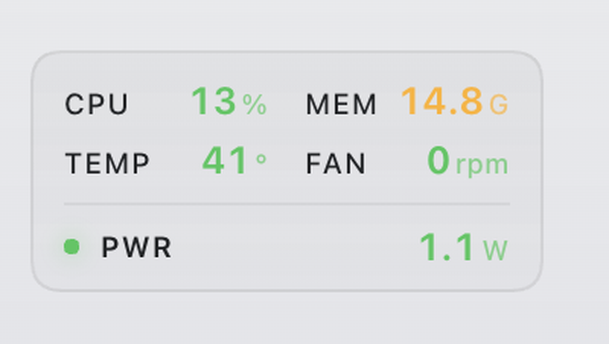

# dsh-power-monitor

**Real-time power draw in your DeepSeek Harness sidebar** — watts first, then CPU, memory, temperature and fan speed, right above your account row.

一个 DeepSeek Harness 社区插件：把你 Mac 的**实时功耗**放到侧栏底部（账号行上方），顺带显示 CPU、内存、温度与风扇转速。

> Why power? Watts are the single number that tells you whether something is quietly burning your battery — a 0.2 W idle and a 22 W runaway look identical in every CPU-percentage widget.



```
CPU 13%   MEM 14.8G
TEMP 41°  FAN 0 rpm
● PWR     1.1W
```

Columns are colour-coded by threshold — green → amber → orange → red — so a hot machine is obvious at a glance.

---

## Requirements

| | |
|---|---|
| OS | macOS on **Apple Silicon** (arm64). Intel Macs are not supported by the bundled binary. |
| DSH | A Desktop build exposing the `sidebar.footer.action` slot |
| Admin | **One** administrator prompt, only if you want temperature / fan / power |

Without the privileged helper the widget still works, showing CPU and memory only.

## Install

### 1. Plugin (no admin)

```bash
git clone https://github.com/chuanjunzhang/dsh-power-monitor.git
cd dsh-power-monitor
./install-plugin.sh
```

This links the package into `~/.dsh/profiles/desktop/node_modules/` and appends `dsh-power-monitor` to the profile's `bundles` list. Restart DeepSeek Harness afterwards.

### 2. Privileged helper (optional, enables TEMP / FAN / PWR)

```bash
./helper/install.sh
```

macOS will ask for your administrator password once. The script installs:

```
/usr/local/libexec/dsh-power-monitor-smc          SMC reader (arm64, reads fan + sensors)
/usr/local/libexec/dsh-power-monitor-helper.sh    sampler loop, writes a snapshot every ~2 s
/Library/LaunchDaemons/com.local.dsh-power-monitor.plist
```

Remove everything with:

```bash
./helper/uninstall.sh
```

## How it works

```
LaunchDaemon (root)
  ├─ dsh-power-monitor-smc ──► SMC keys  ─┐
  └─ powermetrics    ──► watts    ─┴─► /tmp/dsh-power-monitor.json  (every ~2 s)
                                            │
DSH host plugin ── GET /power-monitor/metrics ─────┘
                                            │
DSH client plugin ── sidebar.footer.action ─┘  → renders the card
```

The client polls the host route every 2 seconds. Nothing is sent over the network.

### Why a root daemon?

Reading SMC (fan RPM, die temperatures) and `powermetrics` (power draw) both require root on Apple Silicon. There is no userland API for them — every macOS monitor that shows these values either ships a privileged helper or asks for a password each time.

If you would rather not install a daemon, skip step 2: the widget falls back to CPU and memory, which need no privileges.

## Metrics & thresholds

| Metric | Source | 🟢 | 🟡 | 🟠 | 🔴 |
|---|---|---|---|---|---|
| CPU | Mach `host_statistics` (400 ms delta) | <30% | 30–60% | 60–85% | >85% |
| MEM | `vm_stat` (active + wired + compressed) | <60% | 60–80% | 80–90% | >90% |
| TEMP | SMC `Tp*` sensors, max | <55° | 55–70° | 70–82° | >82° |
| FAN | SMC `F0Ac` | ≤2600 | 2600–4200 | >4200 | — |
| PWR | `powermetrics` cpu+gpu+ane | <4 W | 4–12 W | 12–25 W | >25 W |

The status dot takes the **worst** of CPU / TEMP / PWR.

`FAN` showing **0 rpm** is normal: Apple silicon stops the fan below its start threshold (about 50–60 °C on this machine, minimum spin-up 2317 rpm).

## Known limitations

- **Fanless Macs** (MacBook Air) have no `F0Ac`; the FAN cell stays empty.
- **Temperature keys** are probed from a list of known Apple silicon keys (`Tp00`…`Tp0g`, `Tg0*`). Other SoCs may use different names and report nothing — the card degrades gracefully rather than showing wrong numbers.
- **Bundled binary is arm64 only.** Building for Intel needs a universal build; see `helper/smc.swift`.
- **Power is noisy.** A 250 ms `powermetrics` window sampled every 2 s can differ from what another tool shows at the same instant. The client applies a 3-sample median for display only.
- Relies on DSH's internal slot name `sidebar.footer.action`; a DSH update may rename it.

## Building the binary yourself

```bash
cd helper
swiftc -O smc.swift -o ../bin/dsh-power-monitor-smc
```

Source is ~150 lines of IOKit `AppleSMC` calls — read it before running it as root.

## Privacy

- No network requests leave your machine.
- The daemon writes exactly one file: `/tmp/dsh-power-monitor.json`, world-readable, overwritten every ~2 s.
- Error output goes to `/var/log/dsh-power-monitor.err.log`.

## Uninstall

```bash
./helper/uninstall.sh                     # remove daemon (admin prompt)
rm ~/.dsh/profiles/desktop/node_modules/dsh-power-monitor
# then remove "dsh-power-monitor" from the bundles array in
# ~/.dsh/profiles/desktop/package.json
```

## License

MIT

---

## Repo metadata (for maintainers)

Suggested repository description:

> Real-time power draw, temperature and fan speed in the DeepSeek Harness sidebar — Apple Silicon macOS.

Suggested GitHub topics:

```
deepseek-harness  dsh-plugin  deepseek  cordis  macos  power-monitor  wattage  system-monitor  smc  apple-silicon
```

Search terms this README targets: *DeepSeek Harness 插件*, *DSH plugin*, *macOS 温度监控*, *fan speed menu bar*, *Apple Silicon sensors*.
